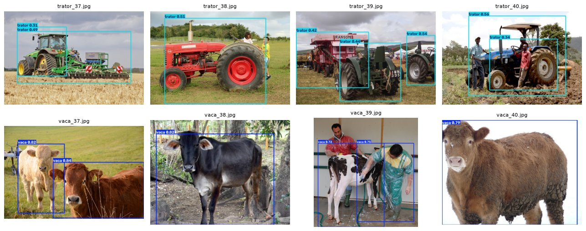

# FIAP

<p align="center">
<a href="https://www.fiap.com.br/"></a>
</p>

<br>

# FarmTech Solutions – Visão computacional com YOLO: vacas × tratores (PBL Fase 6)

## Grupo 62

## Integrantes:

- <a href="https://github.com/ronishime">Ronaldo Keity Sieg Nishime (RM571759)</a>

## Professores:

### Coordenador(a)

- André Godoi

---

## Descrição

A FarmTech Solutions passou a oferecer serviços de visão computacional. Este repositório reúne a demonstração preparada para um cliente fictício, um produtor com rebanho bovino e frota de máquinas: um sistema que reconhece **vacas** e **tratores** em fotos, dois objetos bem diferentes e ligados à saúde animal e à segurança patrimonial da fazenda.

- **Entrega 1:** base de 80 imagens (40 por classe, divididas em 32 treino / 4 validação / 4 teste) organizada no Google Drive, com rótulos no formato YOLO do Make Sense, e um notebook do Colab conectado ao Drive que treina, valida e testa uma **YOLOv5 customizada** em duas simulações (**15 × 30 épocas**).
- **Entrega 2:** comparação crítica da YOLO customizada com a **YOLO padrão** (pesos do COCO, sem customização) e com uma **CNN treinada do zero**, em facilidade de uso, precisão, tempo de treinamento e tempo de inferência.

Todo o passo a passo, as saídas e a discussão dos resultados estão no notebook. Este README só apresenta a solução e indica onde está cada parte.

---

## Entregas 1 e 2 – Notebook principal

➡️ **[RonaldoKeitySiegNishime_rm571759_pbl_fase6.ipynb](RonaldoKeitySiegNishime_rm571759_pbl_fase6.ipynb)**, com todas as células executadas.
[](https://colab.research.google.com/github/ronishime/fiap-fase6-pbl-farmtech/blob/main/RonaldoKeitySiegNishime_rm571759_pbl_fase6.ipynb)

O que o notebook contém:

1. Conexão com o Google Drive. Se a pasta não estiver no Drive, ele baixa a base deste repositório, então qualquer pessoa consegue executá-lo.
2. A base de imagens: origem, curadoria, organização das pastas e a rotulação (formato do Make Sense).
3. **Entrega 1:** treinamento, validação e teste da YOLOv5s em 15 e 30 épocas, com curvas de aprendizado, matrizes de confusão, imagens de teste processadas e a comparação de acurácia, erro e desempenho.
4. **Entrega 2:** YOLO padrão × YOLO customizada × CNN do zero, avaliadas no mesmo protocolo, com o quadro comparativo e a avaliação crítica.
5. Conclusões, pontos fortes e limitações.

**Resultados em resumo** (detalhes e discussão no notebook):

| | Entrega 1 – 15 épocas | Entrega 1 – 30 épocas |
|---|---|---|
| mAP@0,5 validação / teste | 0,27 / 0,12 | **0,93 / 0,95** |
| Tempo de treino (CPU, 320 px) | 5,0 min | 13,5 min |

| Entrega 2 (48 imagens de avaliação) | Acurácia | Treino | Inferência (CPU) |
|---|---|---|---|
| **YOLO customizado** | **100%** | 13,5 min | 84 ms/img |
| YOLO padrão (COCO, sem classe trator) | 50% (95,8% se `truck` contar como trator) | — | 109 ms/img |
| CNN do zero | 50% (não aprendeu com 64 imagens) | 1,0 min | 58 ms/img |

<p align="center"></p>

### Vídeo demonstrativo (Entregas 1 e 2)

▶️ **[Vídeo – Entregas 1 e 2 – YouTube, não listado](https://youtu.be/rguGdvmAwp0)**

---

## Estrutura de pastas

- <b>RonaldoKeitySiegNishime_rm571759_pbl_fase6.ipynb</b>: notebook principal (Entregas 1 e 2), já executado.
- <b>dataset</b>: base do enunciado (a mesma estrutura que fica no Google Drive):
  - `images/train` (64), `images/val` (8), `images/test` (8): fotos `vaca_XX.jpg` e `trator_XX.jpg`;
  - `labels/train`, `labels/val`, `labels/test`: rótulos no formato YOLO do Make Sense (`classe x_centro y_centro largura altura`; 0 = vaca, 1 = trator).
- <b>dataset_teste_extra</b>: 40 imagens extras (20 por classe), usadas só para avaliação na Entrega 2.
- <b>rotulacao_makesense</b>: projeto para abrir no Make Sense (`labels.txt` com as classes e os rótulos de todas as imagens, prontos para *Actions → Import annotations → YOLO*).
- <b>resultados</b>: tudo o que o notebook gera: métricas (`.csv`), curvas e matrizes do YOLOv5, imagens de teste processadas, logs completos dos treinos e os modelos finais (`modelos/`).
- <b>assets</b>: figuras usadas neste README.
- <b>scripts</b>: ferramentas usadas para montar a base a partir do Open Images (seleção, download, pré-rotulação e organização) e para importar um `.zip` exportado do Make Sense de volta para a base. Não é preciso executá-las para rodar os notebooks.
- <b>creditos_imagens.csv</b>: autor, título, licença e link original de cada foto.
- <b>requirements.txt</b>: dependências para execução local.

## Como executar o código

**No Google Colab (recomendado):**

1. Copie as pastas `dataset` e `dataset_teste_extra` para o seu Google Drive em `MyDrive/FIAP/fase6_farmtech/`. Se pular esta etapa, o notebook baixa a base deste repositório sozinho.
2. Abra o notebook pelo botão *Open in Colab* acima e ative a GPU em *Ambiente de execução → Alterar o tipo de ambiente de execução → GPU*.
3. Execute *Ambiente de execução → Executar tudo* e autorize o acesso ao Drive quando for pedido. O notebook clona o YOLOv5, instala as dependências, treina, avalia e grava os resultados em `resultados/`.

**Localmente (Jupyter):**

```
pip install -r requirements.txt
```

```
jupyter notebook RonaldoKeitySiegNishime_rm571759_pbl_fase6.ipynb
```

A execução salva no notebook foi feita assim, em CPU (sem GPU), por isso usa imagens de 320 px e 15 × 30 épocas. Com GPU, dá para voltar ao padrão de 640 px e 30 × 60 épocas trocando dois parâmetros na célula 4.2.

## Créditos das imagens

As 120 fotos vêm do [Open Images V7](https://storage.googleapis.com/openimages/web/index.html) (originalmente do Flickr), sob licença [CC BY 2.0](https://creativecommons.org/licenses/by/2.0/). O autor e o link de cada foto estão em [creditos_imagens.csv](creditos_imagens.csv).

## Histórico de lançamentos

* 1.0.0 - 13/10/2026
    * Entrega 1: base vaca × trator no Drive, rótulos no formato do Make Sense e YOLOv5 customizada (15 × 30 épocas).
    * Entrega 2: comparação com a YOLO padrão e com uma CNN treinada do zero.

## Licença

MODELO GIT FIAP por FIAP está licenciado sobre Attribution 4.0 International.
